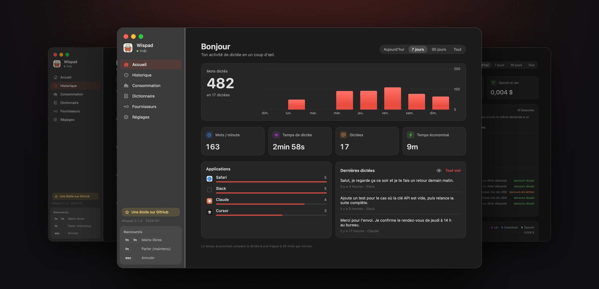
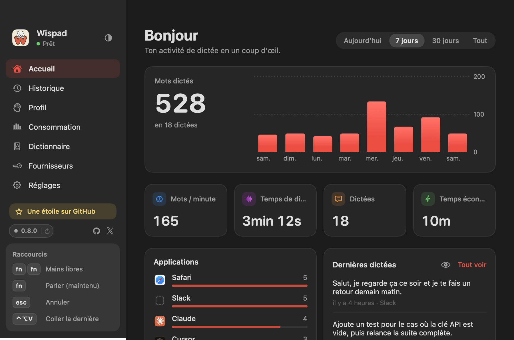
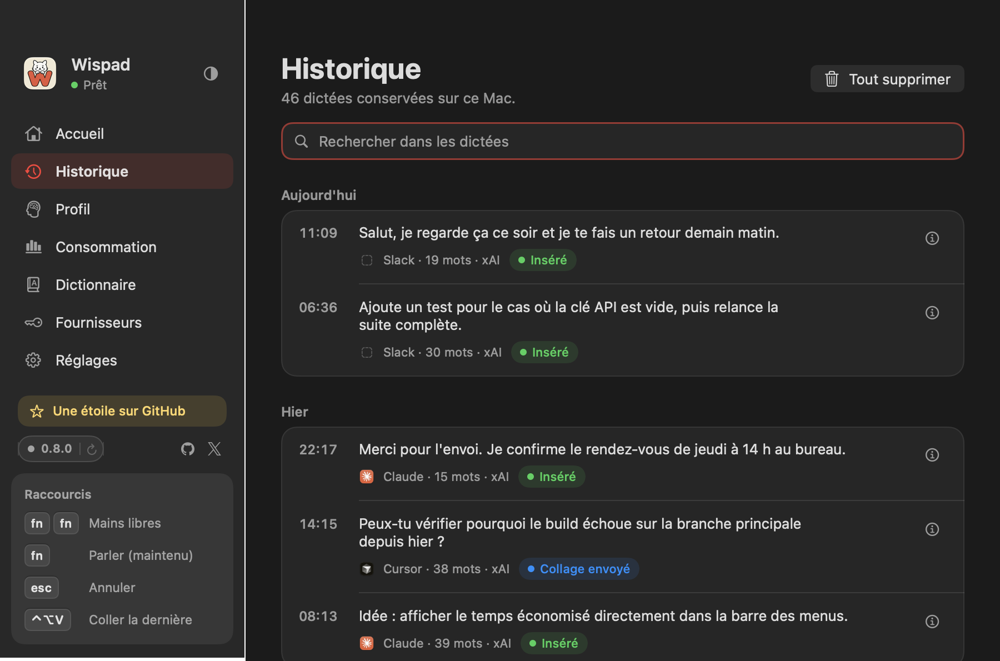
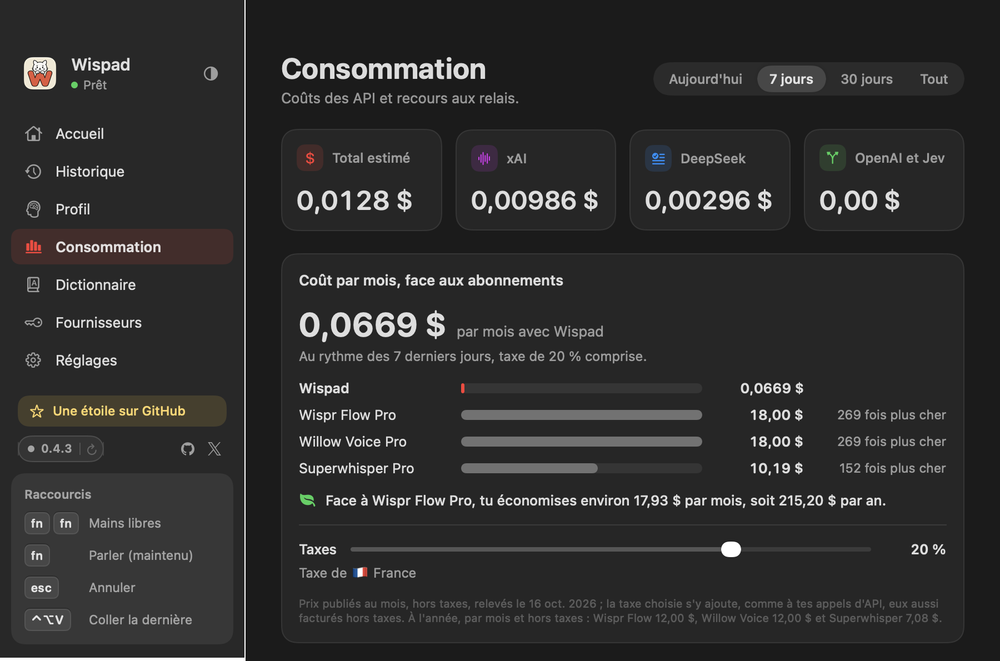
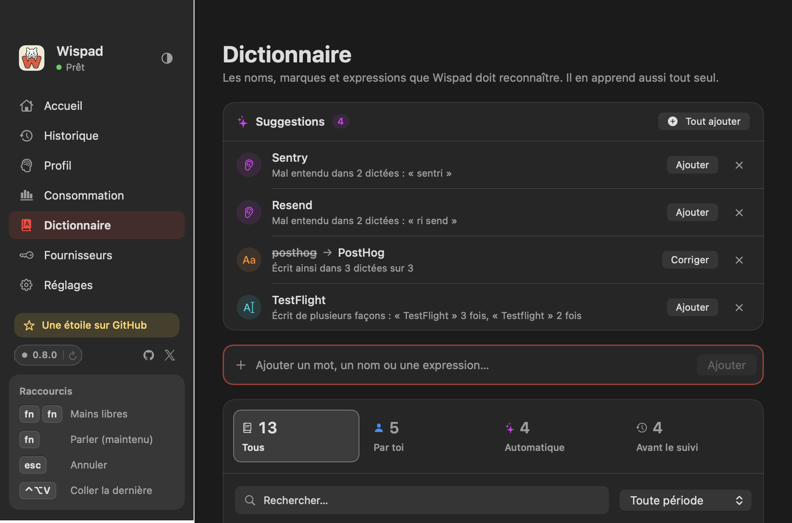
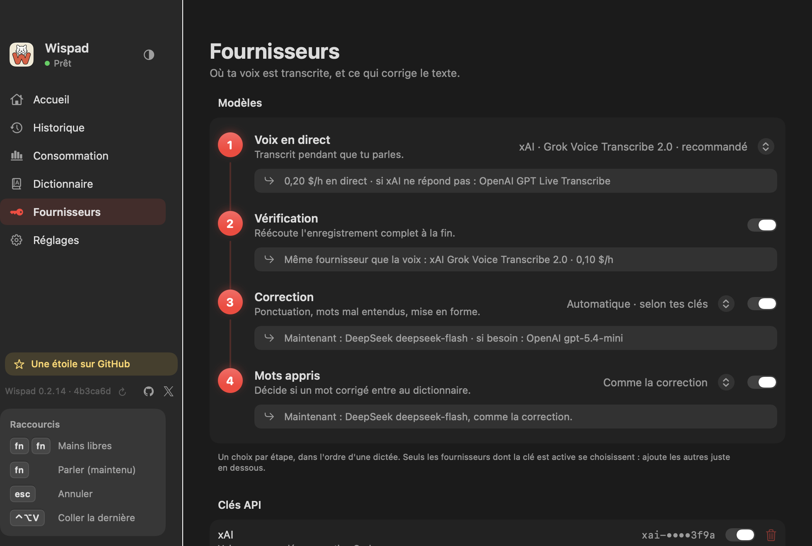

<p align="center">
  
</p>

<p align="center">
  
</p>

<h1 align="center">Wispad</h1>

<p align="center">
  <b>Parle, Wispad écrit.</b><br>
  La dictée vocale open source pour macOS : double appui sur fn, et ton texte, déjà corrigé, s'écrit là où tu tapes.
</p>

<p align="center">
  
  
  <a href="LICENSE"></a>
  <a href="https://github.com/samirmedani/wispad/actions/workflows/ci.yml"></a>
  <a href="https://github.com/samirmedani/wispad/stargazers"></a>
</p>

<p align="center">
  <a href="https://github.com/samirmedani/wispad/releases/latest/download/Wispad.dmg"></a>
</p>

<p align="center">
  <a href="#installer"><b>Installer</b></a> ·
  <a href="#fonctionnalités"><b>Fonctionnalités</b></a> ·
  <a href="#confidentialité"><b>Confidentialité</b></a> ·
  <a href="#contribuer"><b>Contribuer</b></a>
</p>

> *English: Wispad is open-source voice dictation for macOS. Double-press fn, speak, and the text is typed wherever
> your cursor is, in any app, with automatic cleanup (punctuation, technical terms, spoken self-corrections, bullet
> lists) in French and English. Bring your own API keys (xAI, OpenAI, DeepSeek) and pay each provider directly:
> no Wispad server, no account, no telemetry.*

<p align="center">
  
</p>

<p align="center"><sub>Tu te reprends à voix haute, Wispad écrit ce que tu voulais dire.</sub></p>

## Comment ça marche

<p align="center">
  
</p>

| Raccourci | Effet |
| :--- | :--- |
| <kbd>fn</kbd> <kbd>fn</kbd> | Dictée mains libres ; un appui suivant l'arrête. |
| <kbd>fn</kbd> maintenu | Dictée tant que la touche est tenue. |
| <kbd>esc</kbd> | Annule l'écoute, rien n'est inséré. |

Un appui simple au repos ne fait rien : ni micro, ni bulle. La bulle, en verre noir au-dessus du Dock, montre le
spectre de ta voix pendant l'écoute ; le texte transcrit, corrigé puis collé arrive dans l'app où se trouve ton
curseur : messagerie, e-mail, éditeur de code, terminal, navigateur.

## Fonctionnalités

<table>
  <tr>
    <td colspan="2" align="center">
      
      <br><b>Accueil</b> · ton activité en un coup d'œil : mots dictés, mots par minute, temps économisé, apps les plus dictées.
    </td>
  </tr>
  <tr>
    <td width="50%" align="center">
      
      <br><b>Historique</b> · tout est gardé sur ton Mac, cherchable ; une dictée ratée se retranscrit.
    </td>
    <td width="50%" align="center">
      
      <br><b>Consommation</b> · le coût de chaque appel, par fournisseur, et les bascules de secours.
    </td>
  </tr>
  <tr>
    <td width="50%" align="center">
      
      <br><b>Dictionnaire</b> · tes noms, marques et sigles, envoyés à la transcription et à la correction.
    </td>
    <td width="50%" align="center">
      
      <br><b>Fournisseurs</b> · ton fournisseur de voix, tes clés, vérifiées avant d'être enregistrées.
    </td>
  </tr>
</table>

### Une dictée qui écrit comme toi

- **Correction automatique** : ponctuation, majuscules, nombres en chiffres ; hésitations, bégaiements et faux
  départs retirés. Les **autocorrections orales** sont comprises : « mardi, ah non, mercredi » devient « mercredi ».
- **Français, anglais et franglais technique** : langue choisie ou devinée, vocabulaire technique intégré,
  « services functions » réécrit en « serverless functions ».
- **Garde-fou de fidélité** : la correction ne traduit pas tes mots, n'invente ni marque ni nom, ne répond jamais à
  ta place. Sinon, c'est ta transcription qui est collée.
- **Listes et paragraphes** : trois éléments courts deviennent une liste à puces ; « première puce »,
  « nouveau paragraphe » ou « à la ligne » mettent en page à la voix.
- **Dates et heures à ton format** : « le vingt-quatre octobre » devient « 24/10 », « 10/24 » ou « 24 octobre »,
  « à quatorze heures trente » devient « à 14h30 », « à 14 h 30 » ou « à 2:30 PM ». Jamais d'année inventée, et
  « deux heures de route » reste une durée.
- **Montants, pourcentages et unités** : « vingt-cinq euros » devient « 25 € », « quinze pour cent » « 15 % »,
  « cinq kilomètres » « 5 km » ; les grands nombres sont groupés (« 1 500 € ») et les numéros de téléphone
  écrits par paires (« 06 12 34 56 78 »). Années, codes postaux, références et numéros de version ne bougent pas.
- **Ton selon l'app** : « Comme dicté », « Soigné » ou « Détendu », par catégorie (e-mails, messageries, documents,
  notes, code et terminal, navigateur). Le registre change, jamais les mots ni le sens.
- **Réécrire une sélection** : sélectionne un texte et dis « reformule plus poliment », « traduis en anglais » ou
  « rends-le plus court ».

### Rapide et fiable

- **Transcription en direct** pendant que tu parles, et correction préparée à chaque pause : le texte se colle sans
  attendre à la fin.
- **Vérification sur l'enregistrement complet** (réglable) pour fiabiliser les fins de phrase et les mots techniques.
- **Relais en cas de panne** : si un fournisseur ne répond pas, la même demande part chez un autre qui a une clé ;
  le spectre passe au vert pendant le relais.
- **Rien n'est perdu** : sans connexion ou en cas d'erreur, l'audio reste dans l'historique pour **Retranscrire** ;
  un collage raté laisse le texte prêt à **Copier**.
- **La bulle ne cache pas ton champ** : ses messages se placent au-dessus de la zone où tu écris, et chaque bulle se
  place à la main dans Réglages › Bulle, en noir profond ou en verre transparent (Liquid Glass).
- **Contexte facultatif** : Wispad peut lire la fenêtre active pour bien écrire les noms d'une conversation
  (désactivé par défaut, jamais enregistré).

### Il apprend de toi

- Tu corriges à la main un nom mal entendu (« Sidance » → « Seedance ») : Wispad te propose de le **garder** dans
  le dictionnaire, d'un simple Oui / Non dans la bulle.
- **Signaler une erreur** depuis le détail d'une dictée garde, sur ton Mac, de quoi mesurer les progrès.

## Fournisseurs

Wispad n'a pas de serveur : il parle directement aux API, avec **tes clés**. **Tu paies directement chaque
fournisseur**, à l'usage, et l'écran Consommation estime le coût de chaque appel.

| Étape | Qui s'en charge | À savoir |
| :--- | :--- | :--- |
| **Transcription** (ta voix) | **xAI** Grok Voice Transcribe 2.0 *(recommandé)* ou **OpenAI** GPT Live Transcribe | En direct pendant l'écoute ; chez xAI, 0,20 $ de l'heure en direct. |
| **Correction** (le texte) | **DeepSeek** d'abord s'il a une clé, puis **OpenAI**, puis le modèle du fournisseur de voix (**xAI** ou **OpenAI**) | Seul le texte part à la correction, jamais l'audio. |
| **Relais** | L'autre fournisseur, s'il a une clé | Un service en panne est mis de côté, puis repris dès qu'il répond. |

Une seule clé suffit pour commencer (xAI ou OpenAI). Clés facultatives : clé de gestion xAI (solde réel affiché
dans Consommation) et TypeSafe (pour juger les mots appris).

## Confidentialité

- 🚫 **Pas de serveur Wispad** : il n'y en a pas. Ta voix va seulement au fournisseur que tu as choisi.
- 👤 **Pas de compte**, pas d'inscription.
- 📵 **Pas de télémétrie** : ni statistiques ni journal envoyés. En dehors de tes fournisseurs, Wispad ne contacte
  que GitHub : son API publique, pour savoir si une nouvelle version est publiée (sans clé ni cookie), et le
  téléchargement de cette version quand tu cliques sur « Mettre à jour ».
- 💻 **Historique et audio sur ton Mac**, avec une durée de conservation de l'audio réglable. Les journaux ne
  contiennent jamais ce que tu dictes.
- 🔑 **Clés lisibles par ton seul compte** : `~/Library/Application Support/Wispad/api-keys.json`, ou ton propre
  coffre de secrets.

## Installer

### Télécharger l'app

1. Télécharge [Wispad.dmg](https://github.com/samirmedani/wispad/releases/latest/download/Wispad.dmg) (macOS 14 ou
   plus récent, Mac Intel ou Apple Silicon). L'app est signée et notarisée par Apple.
2. Ouvre le fichier, glisse Wispad dans Applications, puis lance-le.

Ensuite, Wispad se met à jour lui-même : quand une version est publiée, la barre latérale affiche « Mettre à jour ».
Un clic télécharge la nouvelle version, vérifie sa signature, la met à la place de l'ancienne et relance Wispad ;
réglages, clés, historique et dictionnaire restent.

Toutes les versions : [Releases](https://github.com/samirmedani/wispad/releases) ; ce qui change à chacune :
[CHANGELOG.md](CHANGELOG.md).

### Compiler depuis les sources

- macOS 14 ou plus récent.
- Xcode 26 ou plus récent (SDK macOS 26), et [XcodeGen](https://github.com/yonaskolb/XcodeGen) (`brew install xcodegen`).
- Une clé API xAI ou OpenAI (DeepSeek en plus pour la correction la moins chère).

#### En trois commandes

```bash
git clone https://github.com/samirmedani/wispad.git && cd wispad
brew install xcodegen
scripts/install.sh    # compile la version Release et l'installe dans /Applications/Wispad.app
```

Au premier lancement, Wispad guide la configuration et vérifie chaque étape : autorisations macOS (micro,
accessibilité, surveillance des entrées), voix au micro, clé API acceptée par le fournisseur, touche fn reçue, puis
une vraie dictée. Rejouable depuis Réglages › Revoir la configuration. Une mise à jour garde réglages, clés,
historique et dictionnaire.

<details>
<summary><b>Signature de l'app</b></summary>

Sans réglage, l'app est signée localement (ad hoc) : elle fonctionne sur ton Mac, mais macOS peut redemander les
autorisations après une nouvelle compilation. Avec un compte Apple Developer, crée `Signing.local.xcconfig`
(ignoré par Git) à la racine :

```
DEVELOPMENT_TEAM = ABCDE12345
CODE_SIGN_IDENTITY = Apple Development
```

</details>

<details>
<summary><b>Clés API et coffre de secrets</b></summary>

Les clés se saisissent dans l'écran Fournisseurs ; elles sont vérifiées chez le fournisseur puis enregistrées dans
`~/Library/Application Support/Wispad/api-keys.json`, lisible par ton seul compte. Tu peux aussi les laisser dans
ton propre coffre de secrets : voir « Clés API » dans [docs/COMPORTEMENT.md](docs/COMPORTEMENT.md).

</details>

### Développer

```bash
scripts/test.sh       # tests locaux, sans micro, réseau, clé ni fenêtre
scripts/build.sh      # build Debug dans build/DerivedData, avec les outils d'aperçu
scripts/install.sh    # version Release dans /Applications/Wispad.app
scripts/check.sh      # tests, traductions et compilation Release
scripts/release.sh    # mainteneur : release GitHub signée et notarisée (voir l'en-tête du script)
```

Le projet Xcode se génère avec `xcodegen generate` ; il n'est pas dans Git. Un build compilé depuis les sources
affiche son retard sur `main` ; seule une release (construite par `scripts/release.sh`) propose les mises à jour.

- `Sources/WispadCore` : logique pure (transcription, correction, garde-fou, historique, coûts).
- `Sources/Wispad` : l'app (dictée, bulle, écrans, clés, traductions).
- [Architecture](docs/ARCHITECTURE.md) : modules, parcours d'une dictée, ajouter un fournisseur, un réglage ou un texte.
- [Comportement](docs/COMPORTEMENT.md) : raccourci, bulle, transcription, correction, relais, apprentissage.

Les tests réseau (`scripts/live-test.sh`, bancs) n'utilisent que des clés de test dédiées, `WISPAD_TEST_XAI_API_KEY`,
`WISPAD_TEST_DEEPSEEK_API_KEY` et `WISPAD_TEST_OPENAI_API_KEY`, lues dans l'environnement (voir
`scripts/test-keys.sh`). Ils coûtent quelques centimes. Les audios du banc franglais se génèrent avec
`scripts/franglais-fixtures.sh` (voix de synthèse de macOS).

Les textes d'interface s'écrivent en français dans le code, puis se traduisent en anglais avec
`scripts/localize.sh` ; `scripts/localize.sh check` doit passer.

## Contribuer

Les contributions sont bienvenues ! Toute modification passe par une pull request relue par le mainteneur : lis
[CONTRIBUTING.md](CONTRIBUTING.md) et [AGENTS.md](AGENTS.md) avant de commencer. Pour un changement de
comportement ou un nouveau fournisseur, ouvre d'abord une issue. Pour signaler une faille : [SECURITY.md](SECURITY.md).

Wispad te rend service ? Une ⭐ sur GitHub aide d'autres personnes à le trouver.

## Contributeurs

- [@samirmedani](https://github.com/samirmedani) : mainteneur.
- [@iamsupersocks](https://github.com/iamsupersocks) : contributeur.
- Claude (Anthropic) : assistant de développement.

Pour contribuer à ton tour : voir [CONTRIBUTING.md](CONTRIBUTING.md).

## Licence

Code sous licence [MIT](LICENSE).
